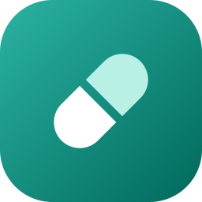
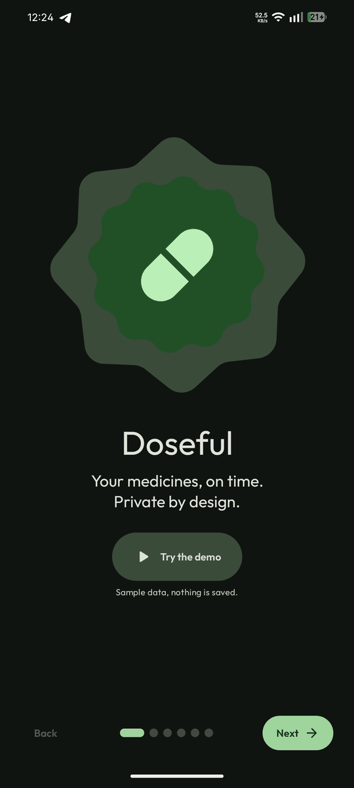
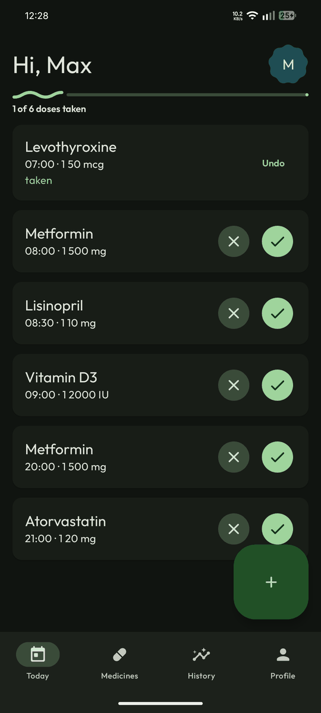
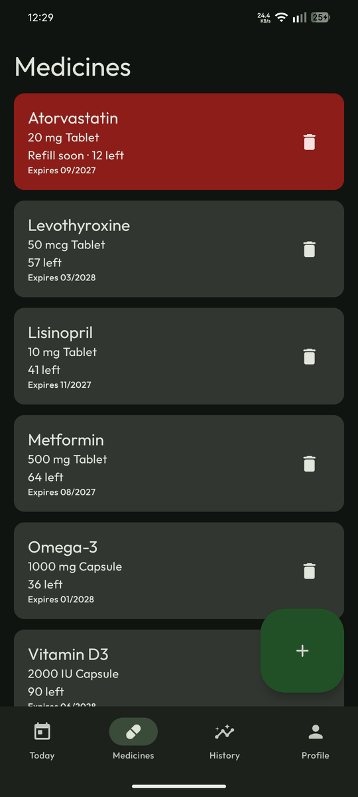
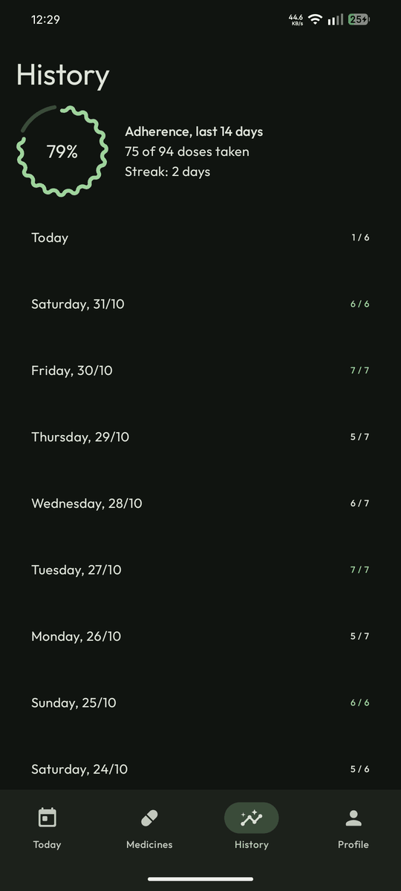
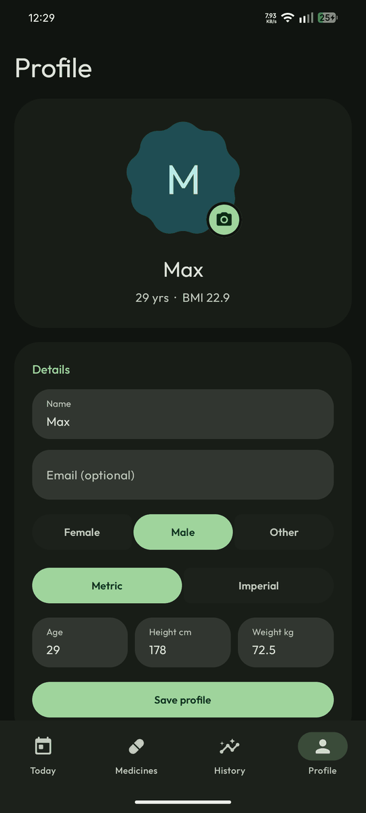

<p align="center">
  
</p>

<h1 align="center">Doseful</h1>

<p align="center">
  <b>A private, offline medication reminder with Material 3 Expressive design.</b>
</p>

<p align="center">
  <a href="https://github.com/maxcodl/Doseful/releases/latest"></a>
  
  
  
  
  <a href="LICENSE"></a>
</p>

<p align="center">
  Track your medicines, get reminders on time, and keep an eye on stock.<br>
  No account. No cloud. No internet permission. Everything stays on your phone.
</p>

## Screenshots

|  |  |  |  |  |
| :--: | :--: | :--: | :--: | :--: |
| Welcome | Today | Medicines | History | Profile |

## Features

- **Reminders that arrive.** Exact alarms with **Taken** and **Skip** buttons right in the notification. Alarms are restored after a reboot, an app update or a timezone change.
- **Flexible schedules.** Several times per day, any days of the week, per medicine.
- **Stock and refills.** Taking a dose lowers your stock. Get a refill alert before a pack runs out, and see expiry dates at a glance.
- **Adherence at a glance.** A 14-day adherence ring, a streak counter and a day-by-day list.
- **Material 3 Expressive.** Morphing shapes, expressive motion, connected toggle buttons, wavy progress indicators and Material You dynamic colour.
- **AMOLED black.** Light, dark or system theme, with an optional true-black mode.
- **Profile with photo.** Pick a picture from the system photo picker. It never leaves the device.
- **Backup and restore.** Export everything to a single JSON file and restore it later.
- **Try before you commit.** A demo mode in onboarding runs the full app on fake data. Your own data is never touched.
- **Tiny.** The release APK is about 1.7 MB.

## Download

Get the latest APK from the **[Releases page](https://github.com/maxcodl/Doseful/releases/latest)** and install it. Android 8.0 (API 26) or newer.

> Releases are signed with the same key every time, so updates install over older versions.

## Privacy

Doseful declares **no `INTERNET` permission**, so it cannot send anything anywhere. There are no accounts, no analytics and no ads. Your medicines, history and profile live in the app's private storage. Backups are plain JSON files that you control.

## Optional: package scanner

Point your camera at a medicine box and the form fills itself in, using on-device text recognition. This needs Google's ML Kit, which is large and closed-source, so it is **a separate add-on app** instead of part of Doseful:

- Doseful itself stays tiny, fully open source and offline.
- Download **Doseful Scanner** from the [Releases page](https://github.com/maxcodl/Doseful/releases/latest) (about 13 MB, arm64 only). Doseful notices it automatically and shows a **Scan package** button.
- The add-on has no network permission either. It only reads the photo and hands the recognised text back to Doseful.

Scanning is best-effort. Always check the filled-in fields against the package.

## Try it with sample data

`docs/sample-backup.json` contains a fake profile and six medicines with two weeks of history. To load it:

1. Copy the file to your phone.
2. Open Doseful, then **Profile, Backup, Restore** and pick the file.

Regenerate it with fresh dates any time: `python docs/make_sample_backup.py`.

## Build from source

You need JDK 17 and the Android SDK (API 37).

```bash
git clone https://github.com/maxcodl/Doseful.git
cd Doseful
./gradlew assembleDebug      # app/build/outputs/apk/debug/
./gradlew assembleRelease    # app and scanner release APKs
```

Release builds are signed with `key.properties` if it exists in the project root, and fall back to the shared Android debug key otherwise:

```properties
storeFile=/path/to/release.jks
storePassword=...
keyAlias=...
keyPassword=...
```

`key.properties` is git-ignored. Never commit it or your keystore.

### Automatic builds

GitHub Actions builds every push and pull request. Pushing a tag such as `v0.1.0` builds the signed release APKs and publishes them as a GitHub Release. See [`.github/workflows/build.yml`](.github/workflows/build.yml) for the secrets it needs.

## Built with

Kotlin, Jetpack Compose, Material 3 Expressive, Room and AlarmManager. The scanner add-on uses Google ML Kit text recognition.

## Credits

- [Outfit](https://github.com/Outfitio/Outfit-Fonts) typeface, SIL Open Font License 1.1 (see [`licenses/`](licenses/)).
- [Material Symbols](https://fonts.google.com/icons) by Google, Apache License 2.0.

## License

Doseful is free software, released under the **GNU General Public License v3.0**. See [LICENSE](LICENSE).
